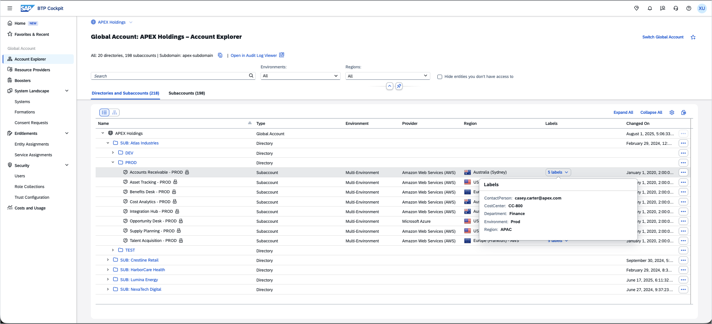

# Getting Started (approx. 5 minutes)

Welcome to **SAP TechEd 2026 XP161 — SAP BTP FinOps Hands-On**.

## The APEX Holdings Account

All exercises run on the **APEX Holdings** demo account — a fictional multinational company on a mock BTP account. No real cloud costs are incurred.

APEX Holdings structure:

- **5 subsidiaries:** Atlas Industries, Lumina Energy, HarborCare Health, Crestline Retail, NexaTech Digital
- **200+ subaccounts** across DEV / TEST / PROD environments under each subsidiary
- **Labels** on every subaccount: Region, Department, Cost Center, Contact Person, Environment
- A **hybrid commercial model:** subscription-based prepaid quotas for specific services + CPEA cloud credits for consumption

---

## Accessing the Session

1. **Open the following link** in a browser. It contains a special parameter that provides access to the APEX Holdings SAP BTP account with mock data:

   [https://emea.cockpit.btp.cloud.sap/cockpit/?idp=tdct3ched1.accounts.ondemand.com&amp;teched-finops-2026=true#](https://emea.cockpit.btp.cloud.sap/cockpit/?idp=tdct3ched1.accounts.ondemand.com&teched-finops-2026=true#)
2. Enter the user name `XP161-XXX@education.cloud.sap`, where `XXX` is the number of your workshop place.For example: `XP161-042@education.cloud.sap`
3. Enter the password for your user as provided to you at the beginning of the workshop.

This will open the **BTP Cockpit** home page. The home page appears empty because APEX Holdings is a mock (demo) account.

4. In the left menu, click **Account Explorer**. Select the **Directories & Subaccounts** tab and verify you can see the APEX Holdings account structure with its subsidiaries and subaccounts.
5. In the left menu, scroll to the bottom and click **Costs and Usage**. You will land on the **Overview** tab. You are ready to begin.

> [!NOTE]
> The data used in this exercise is mock data created specifically for TechEd. All costs and names shown are for demonstration purposes only and should be disregarded.

---

[Continue to: Exercise 1.1 — Cost and Usage Overview →](../ex1/ex1.1/)
