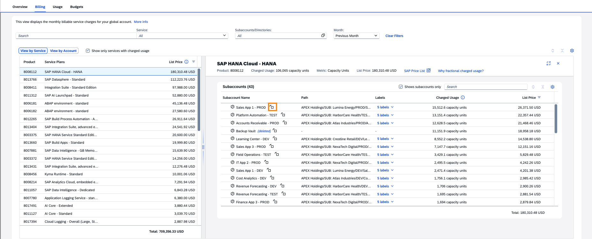

# Exercise 1.3 — Monitoring Costs (approx. 7 minutes)

## Introduction

You've confirmed the Q3 spike is real — now Dana needs to know what drove it.

In this section you will monitor costs and resource consumption by comparing services and subaccounts, analyzing trends, and drilling into detailed data. The objective is to identify the reasons behind the cost increase in the previous month — identified in Exercise 1.2 as the highest-cost month over the past 12 months.

## Investigate the Cost Increase

1. Make sure you're in the **Billing** tab, **View by Service**, with all filters cleared and the **Month** set to **Previous Month**.
2. Which service plan has the highest cost?

   

   
<b>Hint</b>

   Sort the **List Price** column in descending order.

   

   

   
<b>Answer</b>

   **SAP HANA Cloud - HANA**

   *This service plan has the highest cost and is a key focus area for investigating the cost increase.*

   

3. With no service selected, scroll down to the **Global Account — Cost Summary** graph and choose **View By: Cost Breakdown by Service Plan**.

   1. **Expand** the graph.
   2. Find the highest-cost service plan from the previous step. Did its cost increase in the previous month compared to the one before it?

      

      
<b>Answer</b>

      **Yes**

      *SAP HANA Cloud - HANA costs increased from $134K to $180K USD (~$44K delta, over 30%). This upward trend contributes to the overall cost increase and requires investigation to identify which subaccounts are driving the growth.*

      

   3. **Close** the expanded graph.
4. Select the highest-cost service plan in the table.
5. In the right-side panel, review the subaccounts using this service plan.
6. Which subaccount has the highest cost for this service plan in the previous month?

   

   
<b>Hint</b>

   Check **"Show subaccounts only"** and sort **List Price** descending.

   

   

   
<b>Answer</b>

   **Sales App 1 – PROD**

   *This production subaccount is the primary driver of SAP HANA Cloud costs. Identifying the specific subaccount enables targeted investigation.*

   

   
7. For this subaccount, click the switch button (highlighted in the screenshot). This navigates to **View by Account**, showing the costs from the subaccount's perspective.
8. Scroll down to the graph and select **Cost Breakdown by Service Plans**. Can you identify the reason for the cost increase?

   

   
<b>Answer</b>

   *Sales App 1 – PROD began incurring SAP HANA Cloud – HANA costs last month for the first time — rising from $0 to ~$26K USD. This single subaccount accounts for the majority of the overall $44K HANA cost increase.*

   

9. Close the subaccount detail panel.

## Summary

### 🎯 Key Takeaways

- ✅ Drill down from service-level costs to specific subaccounts
- ✅ Identify highest-cost service plans and trace spending increases
- ✅ Interpret Cost Breakdown graphs for data-driven decisions

*For Dana:* You traced the spike to SAP HANA Cloud — the source Dana asked you to find.

---

[← Exercise 1.2 — Billing Verification](../ex1.2/) | [Continue to: Exercise 1.4 — Cross Charge / Cost Allocation →](../ex1.4/)
