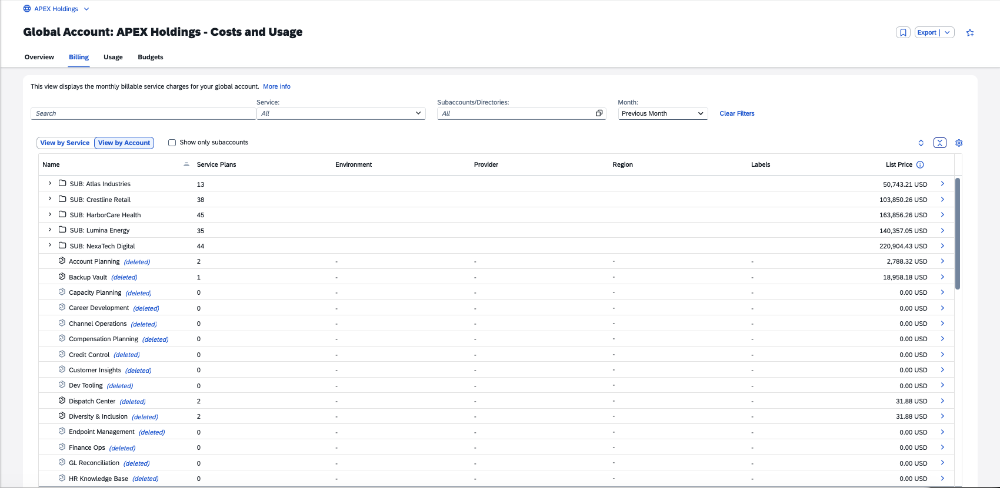

# Exercise 1.4 — Cross Charge / Cost Allocation — (approx. 10 minutes)

> [!TIP]
> **This exercise is optional.** Complete it if you are new to cost allocation in SAP BTP. Otherwise, proceed directly to [Exercise 1.5 — Controlling Costs Using Budgets](../ex1.5/).

## Introduction

**Cross charging** is an internal cost allocation practice where one part of an organization charges another for shared services or resources. It ensures fair cost distribution and helps each business unit reflect the true cost of what it consumes.

In this section you will track costs within the Apex Holdings account hierarchy and distribute expenses across the organization using the account structure and **labels** (Contact Person, Cost Center, Department, Environment, Region).

> [!NOTE]
> This exercise covers cross-charging with today's capabilities. The skills you build here apply directly to your current BTP account. Later in Exercise 2, you'll get a sneak peek at what's coming next.

## Track Costs Using the Account Hierarchy

1. Make sure you're in the **Billing** tab, **View by Account**, with all filters cleared, **"Show only subaccounts"** unchecked, and the **Month** set to **Previous Month**. Click **Collapse All** to view the account hierarchy.
2. You will see 5 **subsidiaries** and a list of subaccounts that had cost or usage during the last 12 months and were subsequently deleted.
3. Select subsidiary **NexaTech Digital**. What is the cumulative list price for the last 12 months?

   

   
<b>Hint</b>

   Scroll down to the graph and choose **View by: Cumulative List Price**.

   

   

   
<b>Answer</b>

   **1,887,337.35 USD**

   *This represents the total cost for NexaTech Digital over 12 months — useful for tracking cost distribution across subsidiaries.*

   

4. Deselect NexaTech Digital.
5. Which subaccount had the highest costs in the previous month?

   

   
<b>Hint</b>

   Select **"Show only subaccounts"** and sort **List Price** descending.

   

   

   
<b>Answer</b>

   **HR App 4 – TEST**

   *This subaccount has the highest costs, indicating a potential optimization or investigation opportunity.*

   

6. Which service plan is responsible for most of its cost?

   

   
<b>Hint</b>

   Select HR App 4 – TEST and scroll down to the graph, choose **View by: Cost Breakdown by Service Plans**.

   

   

   
<b>Answer</b>

   **SAP Integration Suite, advanced event mesh - Default**

   *Investigate whether this usage level is expected or if optimization opportunities exist.*

   

7. View the labels assigned to HR App 4 – TEST. Who is the contact person to notify about the cost?

   

   
<b>Answer</b>

   **logan.ibrahim@apex.com**

   *Logan Ibrahim is the designated contact and should be notified about the cost exceeding 40,000 USD.*

   

8. Check the **Environment** label. Note that it is labeled **"Test"** — a testing environment with costs higher than most production subaccounts. This warrants investigation.
9. Deselect the subaccount and uncheck **"Show only subaccounts"**.

## Cross Charge Using Labels

1. Ensure the **Month** filter is set to **Previous Month**.
2. HR App 4 – TEST is in EMEA. What are the total costs for the EMEA region?

   

   
<b>Hint</b>

   Type **Region** in the search box and choose **Region: EMEA**, or search for **EMEA** directly.

   

   

   
<b>Answer</b>

   **362,710.05 USD**

   *Total cost for the Apex EMEA region in the previous month — useful for regional cross-charging.*

   

3. Bookmark the EMEA filter by clicking the **Bookmark** button. This copies a link you can save or share with the EMEA region owner for ongoing tracking.

## Summary

### 🎯 Key Takeaways

- ✅ Navigate the account hierarchy to compare cost distribution across subsidiaries
- ✅ Use labels (Region, Department, Cost Center, Contact Person, Environment) to filter and aggregate costs
- ✅ Calculate accurate costs for cross-charging using both hierarchy and labels
- ✅ Bookmark and share key views for ongoing tracking

---

[← Exercise 1.3 — Monitoring Costs](../ex1.3/) | [Continue to: Exercise 1.5 — Controlling Costs Using Budgets →](../ex1.5/)
