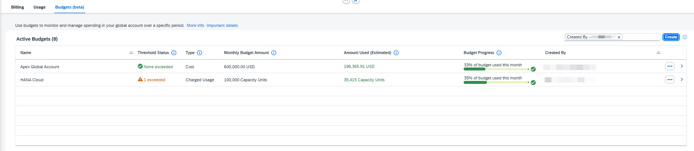
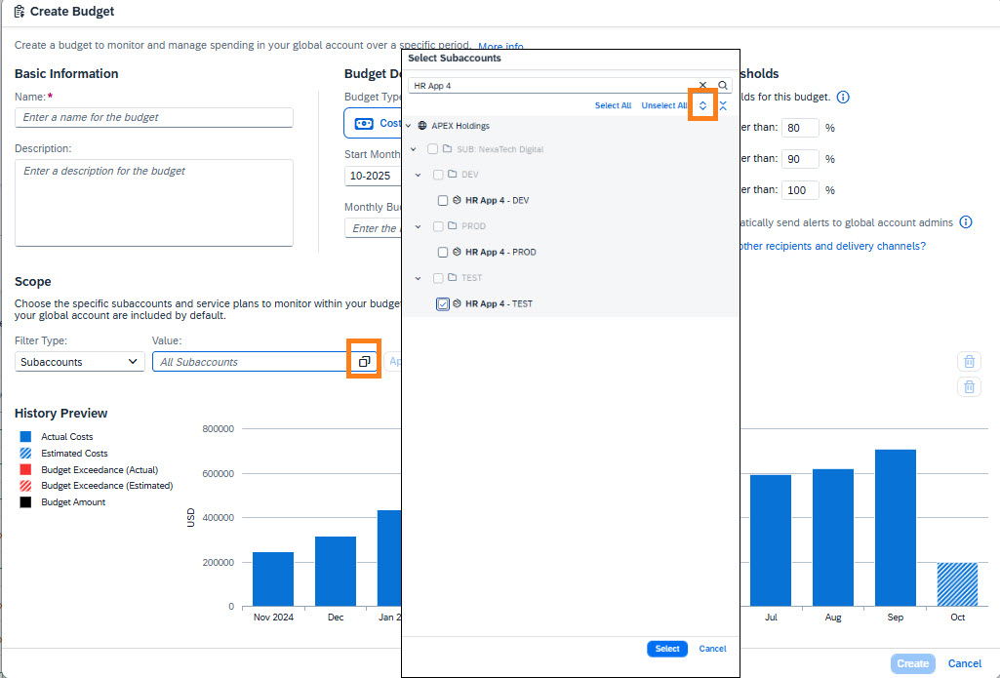

# Exercise 1.5 — Controlling Costs Using Budgets (approx. 10 minutes)

## Introduction

In this section you will manage and control cloud spending with **Budgets** in SAP BTP. Budgets let you set spending limits, configure threshold alerts, and integrate with external notification channels.

<b>What are Budget Thresholds and Alert options?</b>

### Budget Thresholds

Each budget includes three default thresholds (80%, 90%, 100%) that you can adjust or disable.

### Alert Options

When a threshold is reached, you can choose one or more notification channels:

1. **Visual Indicators** — show threshold status (0–3 exceeded) on the Costs and Usage page.
2. **Email Alerts** — automatically notify Global Account Administrators.
3. **Custom Alerts** — use SAP Alert Notification Service to send alerts to specific recipients or channels (Teams, Slack, webhook endpoints).

See: [How to enable SAP Alert Notification for SAP BTP](https://help.sap.com/docs/alert-notification/sap-alert-notification-for-sap-btp/alerting-events) and the [Budget Threshold Exceedance Event](https://help.sap.com/docs/alert-notification/sap-alert-notification-for-sap-btp/budget-threshold-exceedance-beta?version=Cloud).

## Create a Cost-Based Budget for a Specific Subaccount

**Scenario:** HR App 4 – TEST was identified in Exercise 1.4 as the highest-cost subaccount. You will create a budget for it with custom thresholds and email alerts.

1. Navigate to the **Budgets** tab.
2. Click **Create**.
3. Enter a name: `HR App 4 TEST costs`
4. Keep the default **Cost** budget type (tracks monetary value at list price).
5. Keep the default date range — starts immediately from the current month, with no end date.

6. **Scope:**

   - Select filter type: **Subaccounts**
   - Click the squared icon (highlighted in the screenshot) to open the selection dialog
   - Search for: `HR App 4`
   - Expand the results and choose: **HR App 4 – TEST**
   - Click **Select**, then click **Apply** in the Scope section to confirm your selection
   - The history preview updates to show HR App 4 – TEST cost trend for the last 12 months

   

   > You can scope budgets by subaccounts, services, or a combination. This flexibility aligns budgets with your organizational structure.
   >
7. **Amount:** Enter `40,000` USD.

   > Budgets track actual consumption, not prepaid quota, so they focus on costs that directly impact your bill.
   >
8. Review the **History Preview** — it shows the budget line and thresholds alongside actual historical costs.
9. **Thresholds:** Change the percentages to **20%**, **50%**, and **80%** to create more frequent alerts for this high-cost subaccount.
10. Review the updated history preview with the new thresholds.
11. Toggle on **"Automatically send alerts to global account admins"**.
12. Click **Create**.
13. In the **Active Budgets** table, verify your new budget appears.

    **Are any thresholds already exceeded?**

    

    
Answer

    **Yes** — one threshold has been exceeded.

    *Budgets are evaluated for the current month only. Previous months' exceedances do not carry over. Check the threshold indicators in the Budgets table.*

    

> [!TIP]
> You can also create a **Charged Usage** budget to track actual resource units consumed (e.g., users, GB of storage) rather than their monetary value.

## Summary

### 🎯 Key Takeaways

- ✅ Create and manage cost-based budgets scoped to specific subaccounts
- ✅ Distinguish Cost-based vs. Charged Usage budget types
- ✅ Configure custom threshold percentages for early alerting
- ✅ Enable email notifications and SAP Alert Notification Service integration
- ✅ Understand how visual indicators signal budget exceedances at a glance

---

[← Exercise 1.4 — Cross Charge / Cost Allocation](../ex1.4/) | [Continue to: Exercise 1.6 — Optimization →](../ex1.6/)
