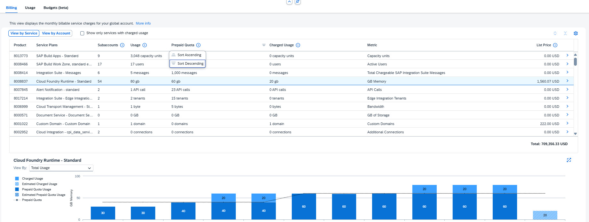

# Exercise 1.6 — Optimization (approx. 7 minutes)

## Introduction

In Exercise 1.1 you spotted that Cloud Foundry Runtime is exceeding its prepaid quota — here you confirm the overage and identify the right action.

In this section you will identify cost and utilization optimizations for the Apex Holdings global account, focusing on prepaid quota management.

BTP offers many optimization opportunities — contract rightsizing, cloud credit management, and more. In this exercise we focus on one of the most impactful: prepaid quota utilization.

## Optimizing Prepaid Quota Utilization

**Scenario:** Identify where Apex Holdings is paying consumption-based overage charges that could be eliminated by purchasing additional subscription quota.

1. Make sure you're in the **Billing** tab, **View by Service**, with all filters cleared and the **Month** set to **Previous Month**. Confirm **"Show only services with charged usage"** is **unchecked**.
2. Sort the **Prepaid Quota** column **descending** to show services with the highest quotas first.
3. Review services with prepaid quota. Most have zero Charged Usage and zero List Price — they are consuming within their subscription entitlement.
4. Identify the one service that has both a prepaid quota **and** a non-zero List Price (indicating overage).

   

   
Answer

   **Cloud Foundry Runtime - Standard**

   *This service has exceeded its prepaid quota and is incurring consumption-based charges for the overage.*

   

5. Select **Cloud Foundry Runtime - Standard**. Scroll down to the graph and choose **View by: Total Usage**.
6. Analyze the 12-month trend:

   - Prepaid quota started at **40 GB**; usage was initially 30 GB, then grew to 40 GB
   - Apex purchased an additional 20 GB subscription, raising the quota to **60 GB**
   - Usage continued to grow to **80 GB**, creating a **20 GB overage** charged at consumption rates

> [!TIP]
> The dotted line in the graph represents the prepaid quota. When the solid usage line exceeds it, you pay consumption-based overage charges.

7. **How can Apex optimize Cloud Foundry Runtime costs?**

   

   
Answer

   **Purchase an additional 20 GB of prepaid quota subscription**

   *Subscription pricing is lower than consumption-based overage rates. When usage is consistent and predictable, buying quota upfront reduces the total cost.*

   

## Summary

### 🎯 Key Takeaways

- ✅ Identify services where usage exceeds prepaid quota and overage is being charged
- ✅ Use 12-month usage trends to make data-driven subscription purchasing decisions

> [!TIP]
> Review prepaid quota utilization monthly to catch trends early and make timely purchasing adjustments.

---

[← Exercise 1.5 — Controlling Costs Using Budgets](../ex1.5/) | [Continue to: Exercise 1.7 — Export to Excel →](../ex1.7/)
