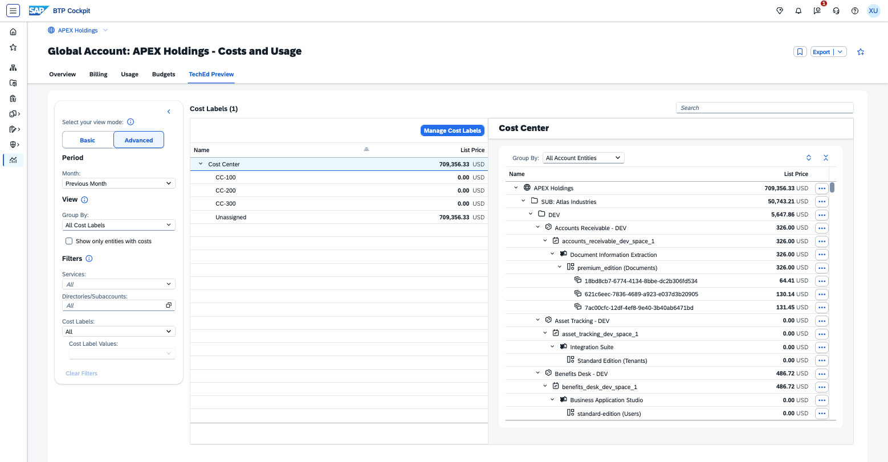

# Exercise 2.2 — Advanced View: Cost Breakdown & Label Assignment (~8 minutes)

**Goal:** Create a **Cost Center** cost label and assign it to the Apex Holdings account hierarchy — mapping each subsidiary to its dedicated internal cost center.

**Scenario:** Assign cost centers to three of APEX Holdings' five subsidiaries for budget reporting and charge-back:

- **Lumina Energy** → **CC-100**
- **NexaTech Digital** → **CC-200**
- **Crestline Retail** → **CC-300**

Atlas Industries and HarborCare Health are left unassigned — the same assignment flow applies and is omitted here for brevity. One decommissioned subaccount — **Backup Vault** — still carries last month's costs with no cost center tag; you'll tag it to demonstrate that advanced cost labels are decoupled from the entity lifecycle.

Assignments are made at the subsidiary (directory) level, and all child subaccounts inherit automatically.

## Switch to Advanced View and Create the Cost Center Label

> Continue in the **TechEd Preview** tab you opened in Exercise 2.1.

1. In the left sidebar, click **"Advanced"**.
   1. A popup appears — *"We've added a sample cost label to help you get started!"*. Close it by clicking the **X** in the top-right corner.
2. In the **Group By** dropdown, confirm **Cost Labels → All Cost Labels** is selected.
   1. The system shows default **Sample** labels — these are placeholders. You'll rename them to create a **Cost Center** dimension for internal allocation.
3. Click **Manage Cost Labels** and update the sample label:
   - Rename the label key to **"Cost Center"** (remove *(Sample)*)
   - Rename the three values to **"CC-100"**, **"CC-200"**, and **"CC-300"** (remove *(Sample)* from each)
   - Delete the 4th sample value
   - Click **Save**. A **"Saved Changes"** popup appears confirming your label was created.
     Click **Close** — the exercise will guide you to the side panel in the next section.

**Expected result:** Your "Cost Center" label with values CC-100, CC-200, and CC-300 is ready.

## Explore the Granular Cost Breakdown

1. In **Group By**, select **Account → All Account Entities**.
2. The table now shows the full hierarchy down to **Cloud Foundry Space** and **Service Instance**.

**In Exercise 1.3 you identified Sales App 1 – PROD as the source of the HANA cost spike. Can you now drill deeper to see the exact instance responsible?**

Hint

Drill down: **Lumina Energy → PROD → Sales App 1 – PROD → sales_app_1_prod_space_1 → SAP HANA Cloud → HANA (Capacity Units)**

Answer

Yes — SAP HANA Cloud costs are visible at the instance level. There are 3 instances in the subaccount. The one contributing most to the spike is instance `7ba838b5-0328-4145-a27f-bed7a6dc8a8b`, with a cost of **15,822.90 USD** last month.

> [!NOTE]
> Cost breakdown to space or instance level is optional and may not be supported for all services.

## Assign Cost Centers to Subsidiaries

> [!TIP]
> **Exercise 1 ceiling you're crossing here:** One directory-level assignment cascades to all 40+ child subaccounts instantly — no individual updates. And if a subaccount is later deleted, the label assignment survives.

**Assign Lumina Energy → CC-100:**

1. In the main table, find the **Lumina Energy** directory (top-level subsidiary under APEX Holdings).
2. Click on it to open the details pane. Click **Edit**.
3. In the **Cost Center** field, select **CC-100**. Click **Save**.
4. Close the details pane to see the updated table.
5. Observe: a label icon appears next to **Lumina Energy**. Its costs — and the costs of all its child entities — now appear in the **CC-100** column.
6. Expand **Lumina Energy → PROD → Sales App 1 – PROD**. In the details pane, the label shows as **Inherited** from Lumina Energy. No label icon appears next to the subaccount name (icons indicate direct assignment only).

**Repeat the same flow for the remaining subsidiaries:**

7. **NexaTech Digital → CC-200** — close the pane and verify that **HR App 4 – TEST** (40,000+ USD) now appears in the CC-200 column.
8. **Crestline Retail → CC-300** — close the pane and verify its costs appear in CC-300.

**Tag a deleted subaccount — Backup Vault:**

Last month **Backup Vault** was decommissioned, but its costs are still visible in the previous month's data. It appears in the table without a parent directory — an orphaned row.

9. Scroll to the bottom of the entity list to find **Backup Vault**.
10. Click on it → **Edit** → select **CC-100** → **Save**.
11. Close the details pane to see the updated table.

> [!NOTE]
> **Backup Vault** no longer exists in the account structure, yet its label assignment and costs are still attributed. Unlike the standard Billing tab — where a deleted subaccount takes its labels with it — cost label assignments here are independent of the entity lifecycle.

**Expected result:** Lumina Energy (CC-100), NexaTech Digital (CC-200), Crestline Retail (CC-300), and Backup Vault (CC-100) are assigned. Atlas Industries and HarborCare Health remain unassigned.

**What are the costs per cost center, and how much remains unassigned?**

Hint

In **Group By**, select **Account → All Account Entities** — the cost center columns are visible directly in the main table.

Answer

| Cost Center | Amount         |
| ----------- | -------------- |
| CC-100      | 159,315.23 USD |
| CC-200      | 220,904.43 USD |
| CC-300      | 103,850.26 USD |
| Unassigned  | 225,286.41 USD |

Atlas Industries and HarborCare Health account for the unassigned portion.

## Label Inheritance and Override at Instance Level

Sales App 1 – PROD inherits **CC-100** from Lumina Energy. Inside it, three SAP HANA Cloud instances share the same space — but each is used by a different team. Two of them should be attributed to different cost centers.

1. Expand **Lumina Energy → PROD → Sales App 1 – PROD → sales_app_1_prod_space_1**.
2. You will see three SAP HANA Cloud – HANA instances, all currently showing costs in the **CC-100** column (inherited from Lumina Energy).
3. Click on instance `cce2dd07-0931-4355-95c8-aa037a88f83c` → **Edit** → deselect **CC-100**, select **CC-200** → **Save**.
4. Override instance `30eeba60-2008-4dc9-bf2b-9db1f358e8a4` with **CC-300** the same way.
5. View the result in the main table.

**How are Lumina Energy's costs now distributed across cost centers?**

Answer

| Cost Center | Amount         |
| ----------- | -------------- |
| CC-100      | 129,808.45 USD |
| CC-200      | 6,592.45 USD   |
| CC-300      | 3,956.15 USD   |

> **Key insight:** Overrides work at any level of the hierarchy — from subsidiary down to individual service instance. The details pane always shows whether a label is **Inherited** or **Direct**, so you can audit every assignment at a glance.

---

[← Exercise 2.1 — Basic View](../ex2.1/) | [Continue to: Exercise 2.3 — Fixed Cost Allocation →](../ex2.3/)
