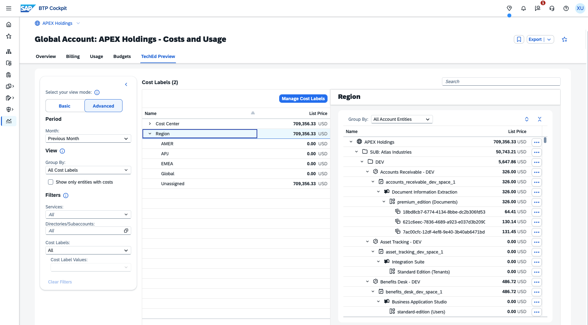
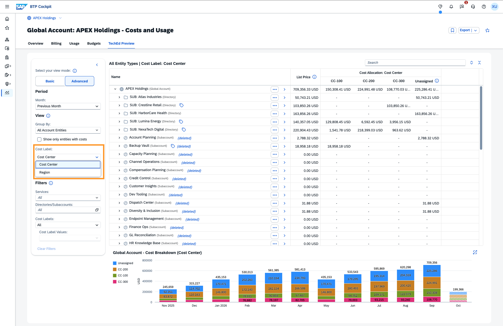
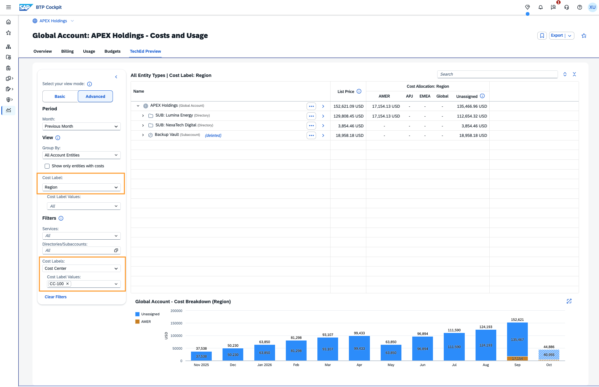

# Exercise 2.4 — Add a Second Cost Label Dimension — Optional (~5 minutes)

> [!TIP]
> **This exercise is optional.** Complete it if time allows.

Dana also wants to see costs by geography, not just by cost center.

**Goal:** Add a second independent cost label dimension for regional cost reporting — enabling **Dana** to slice BTP costs by geography alongside the Cost Center dimension from Exercise 2.2.

**Scenario:** APEX Holdings subsidiaries are multinational companies with operations distributed across regions. Cost center reporting answers *"which business unit is responsible?"* — but **Dana** also needs to answer *"which region drove this spend?"* for regional cross-charge reporting and geographic budget allocation.

The two dimensions are fully independent: a workload in CC-200 might serve EMEA, AMER, or APJ. Regional reporting cuts across cost centers without restructuring the account.

APEX Holdings uses four regions: **EMEA**, **AMER**, **APJ**, and **Global** (for shared services with no single regional owner). You already know where two key workloads operate from Exercise 1:

- **Sales App 1 – PROD** (Lumina Energy) serves the **AMER** market
- **HR App 4 – TEST** (NexaTech Digital) serves the **APJ** region

## Create the Region Label

> Continue in the **TechEd Preview** tab, **Advanced** view.

1. In **Group By**, confirm **Cost Labels → All Cost Labels** is selected.
2. Click **Manage Cost Labels**. In the panel that opens, scroll to the bottom and click **"+ Add Cost Label Key"**.
3. Name the key: **"Region"**
4. Add 4 values: **"EMEA"**, **"AMER"**, **"APJ"**, **"Global"**
5. Click **Save**. The same **"Saved Changes"** confirmation popup appears — click **Close**.

**Expected result:** Your second label "Region" with 4 values is ready alongside "Cost Center".

## Assign Regions to Known Workloads

1. Switch to **Account → All Account Entities** in **Group By**.
2. In the left sidebar under **View**, set **Cost Label** to **"Region"**.
3. Assign **AMER** to **Sales App 1 – PROD** — expand **Lumina Energy → PROD → Sales App 1 – PROD**, click it to open the details pane, click **Edit**, select **AMER**, then **Save**.
4. Assign **APJ** to **HR App 4 – TEST** — expand **NexaTech Digital → TEST → HR App 4 – TEST**, click it to open the details pane, click **Edit**, select **APJ**, then **Save**.

## Observe the Two Dimensions Side by Side

1. Switch **Cost Label** to **"Cost Center"** — the full cost center allocation (**CC-100**, **CC-200**, **CC-300**) is unchanged from Exercises 2.2–2.3. Even though **Sales App 1 – PROD** and **HR App 4 – TEST** now also carry a **Region** label, their Cost Center allocation is untouched. The two dimensions coexist as independent perspectives on the same costs — neither overwrites the other.
2. Switch **Cost Label** back to **"Region"**.

## Cross-Dimensional Reporting

1. Keep **Group By → Account → All Account Entities** and set **View → Cost Label** to **Region**. The table's **Cost Allocation: Region** columns (AMER, APJ, EMEA, Global, Unassigned) now show total BTP cost per region across all of APEX Holdings.

**What is the total cost for AMER workloads within CC-100?**

Hint

Keep **View → Cost Label: Region** and filter by **Cost Label → Cost Center → CC-100**.

Answer

**17,154.13 USD**

> [!TIP]
> The two label dimensions answer different questions from the same data. Cost Center answers: *"Which business unit do we charge?"* Region answers: *"Which geography drove the spend?"* Filtering by one while viewing the other makes cross-dimensional reporting possible without modifying the account structure or duplicating any data.

---

[← Exercise 2.3 — Fixed Allocation](../ex2.3/) | [Continue to: Exercise 2.5 — Export to Excel (Optional) →](../ex2.5/)
