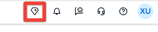
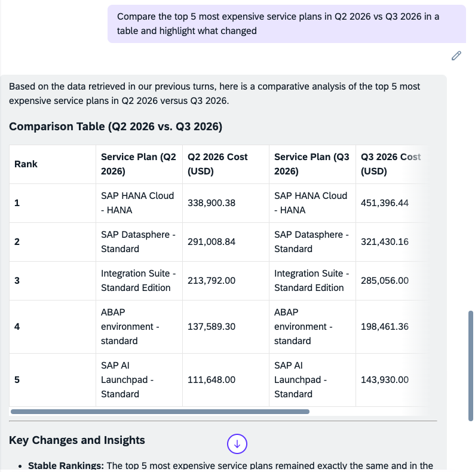

# Exercise 3.1 — Q2 vs Q3 Service Plan Comparison (~5 minutes)

**Dana's question:** *"How did our most expensive service plans change from Q2 to Q3?"*

You'll pull each quarter's most expensive service plans, then let Joule build the comparison for you.

---

## Compare Service Plans

Open **Joule** by clicking the **Joule icon**  in the **top-right corner** of the BTP Cockpit. Start with Q3:

> **"What are the top 5 most expensive service plans in Q3 2026?"**

Joule returns a ranked list — and a chart — of the five costliest service plans for the quarter, highest first. Note which plan tops the list; you'll compare it against Q2 next.

Now ask for Q2:

> **"What are the top 5 most expensive service plans in Q2 2026?"**

Joule retains context, so ask it to build the comparison for you:

> **"Compare the top 5 most expensive service plans in Q2 2026 vs Q3 2026 in a table and highlight what changed"**

Joule returns a comparison table with Q2 and Q3 costs side-by-side and a cost change column — here's what to expect:

**What to look for:** **SAP HANA Cloud - HANA** rises to the top in Q3 — the same spike you traced in Exercise 1.3. The quarter-over-quarter jump confirms the ~25% increase Dana mentioned.

---

> **For your reply to Dana:** keep the comparison table — it goes straight into the reply you draft in Exercise 3.2.

---

[← Exercise 3 Overview](../README.md) | [Continue to: Exercise 3.2 — Draft the Reply to Dana →](../ex3.2/)
