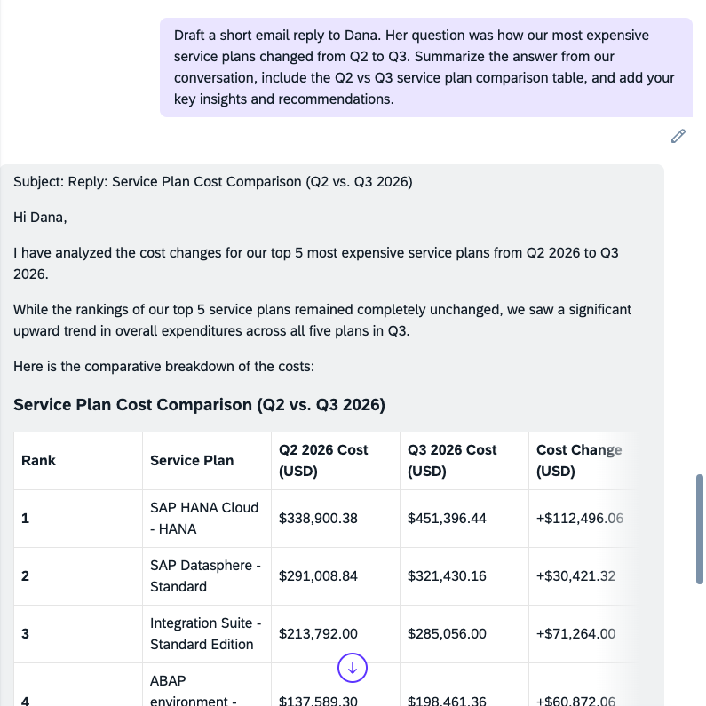

# Exercise 3.2 — Draft the Reply to Dana (~5 minutes)

You now have the answer. Dana doesn't want a screenshot — she wants one clear reply she can act on. Joule retains the context of this conversation, so it can assemble the reply for you.

---

## Ask Joule

Joule knows the answer from this conversation, but not what Dana originally asked — so include her request in the prompt:

> **"Draft a short email reply to Dana. Her question was how our most expensive service plans changed from Q2 to Q3. Summarize the answer from our conversation, include the Q2 vs Q3 service plan comparison table, and add your key insights and recommendations."**

Joule composes a complete reply with subject line, intro, the comparison table, and recommended next steps — here's what to expect:

*Joule's phrasing may vary slightly from run to run, but the numbers stay the same.*

---

## What to Look For

Joule composes a reply built from the comparison you ran in Exercise 3.1 — and, because you asked for insights, adds its own observations and recommended next steps rather than just restating the numbers.

Review the draft:

- Does it answer Dana's question?
- Is the comparison table from Exercise 3.1 included and correct?
- Do the insights give Dana something actionable for the board — not just data?

Refine with a follow-up if needed (for example, *"make it more concise"* or *"lead with the biggest change"*), then you have a board-ready reply drafted in seconds.

---

## Exercise 3 Summary

### 🎯 Key Takeaways

- ✅ Joule answers cost analysis questions in natural language — no dashboard navigation
- ✅ Joule pulls each quarter's figures and builds the comparison for you
- ✅ Joule retains conversation context, so it can combine prior answers into a single drafted reply
- ✅ Asking for insights turns raw figures into board-ready recommendations
- ✅ Every answer traces back to what you found in Exercises 1 and 2 — same data, faster

---

## Session Conclusion

Across this session you ran a complete FinOps investigation for APEX Holdings — one story from start to finish:

- **Part 1 — Cost Visibility and Control:** verified the Q3 spike against the billing statement, traced it to SAP HANA Cloud, set a budget guardrail on the highest-cost subaccount, and found a prepaid-quota optimization.
- **Part 2 — Advanced Cost Allocation:** turned subaccount names into cost center attribution, split a shared HANA instance across business lines, and added a regional dimension.
- **Part 3 — Ask Joule:** answered Dana's Q2-vs-Q3 question in natural language and had Joule draft her board-ready reply — the same data, in seconds.

You now have a working toolkit for cost visibility, allocation, control, and AI-assisted reporting on SAP BTP.

**This concludes the SAP TechEd 2026 XP161 FinOps Hands-On session. Thank you for participating!**

---

[← Exercise 3.1 — Q2 vs Q3 Comparison](../ex3.1/) | [← Back to Session Overview](../../../README.md)
