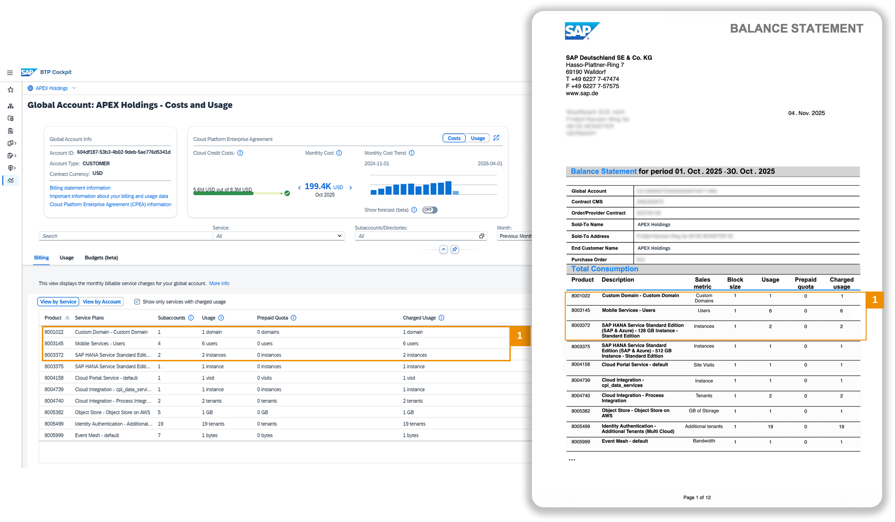
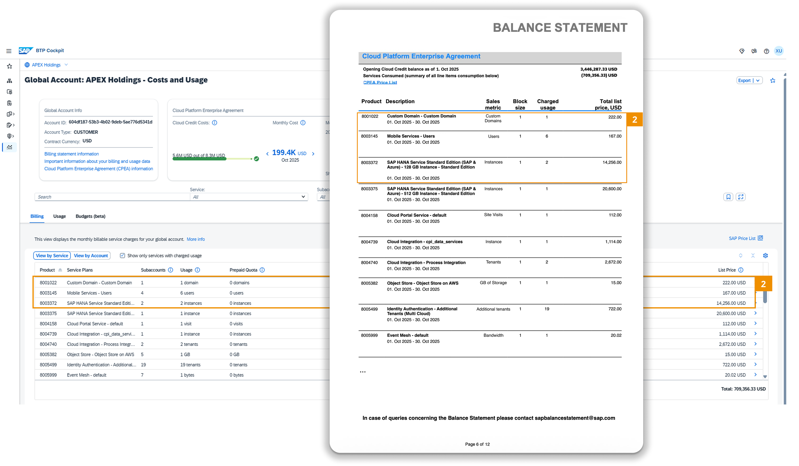
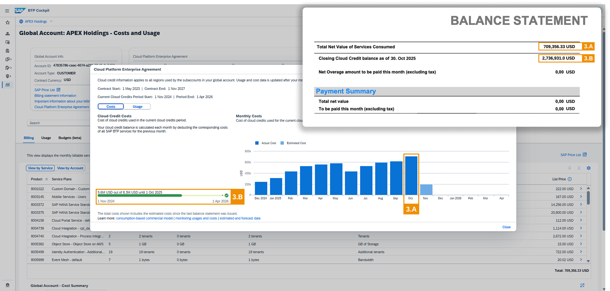

# Exercise 2 - Billing Verification (approx. 10 minutes)

## Exercise 2.1 - Orientation

1. You are on the **Overview** tab. Scroll to the **footer** of the page and click the **"Billing Statement Information"** link. This links to SAP for Me where you can download the Balance Statement. For this exercise, screenshots are provided — no SAP for Me login is needed.
2. Click the hamburger icon  in the top-left corner to collapse the left pane and expand the viewing area.
3. Navigate to **Billing → View by Service**.
4. Clear all filters and set the month to **Previous Month**.

> [!NOTE]
> The **Billing** tab displays and analyzes monthly charges for all billable services consumed over the last 12 months. Two perspectives are available:
>
> - **View by Service** — suited for billing verification; ordered as in the balance statement.
> - **View by Account** — suited for cross-charging; shows account hierarchy with costs per entity.

**Screenshot: Billing Views by Service**

## Exercise 2.2 - Compare the Balance Statement with BTP Cockpit

> [!NOTE]
> The Balance Statement is the starting point for monthly cost verification. Screenshots from the previous month's balance statement are provided below for comparison.

**Screenshot #1: Balance Statement — Total Consumption Section**

1. The default view is **Billing → View by Service**, sorted automatically by Product (SKU) — matching the balance statement order.
2. Select **"Show only services with charged usage"** to filter out services with zero cost. Compare what disappears with what the balance statement shows.
3. Compare the **Usage**, **Prepaid Quota**, and **Charged Usage** columns for the first three services against screenshot #1. If unsure what a column means, click its ⓘ icon.

**Screenshot #2: Balance Statement — Cloud Platform Enterprise Agreement Section**

4. Compare the **List Price** column for the first three services against screenshot #2.
5. Notice that the BTP Cockpit aggregates both balance statement sections into a single view, enabling drill-down per service.

**Screenshot #3: Balance Statement — Cloud Credits and Payment Summary**

6. Cloud credit details are available in the **Overview tab** — refer to the **Cloud Platform Enterprise Agreement** card you explored in Exercise 1 to verify consumed and remaining cloud credits against the balance statement.
7. In screenshot #3 (section 3.B), the balance statement shows **remaining cloud credits**. Confirm this matches what you saw in the CPEA card on the Overview tab.
8. Remaining cloud credits mean no Net Overage Amount — the Payment Summary shows no additional costs to pay.

> **Note:** Billing verification confirms all charges are accurate. This establishes confidence in the data before further cost analysis.

## Summary

### 🎯 Key Takeaways

- ✅ Find the Billing Statement Information link in the Overview tab footer
- ✅ Verify balance statement data systematically against the BTP Cockpit Billing view
- ✅ Validate cloud credit balances using the CPEA card on the Overview tab

---

[← Previous: Exercise 1 - Cost and Usage Overview](../ex1-cost-overview/) | [Continue to: Exercise 3 - Monitoring Costs →](../ex3-monitoring-costs/)
