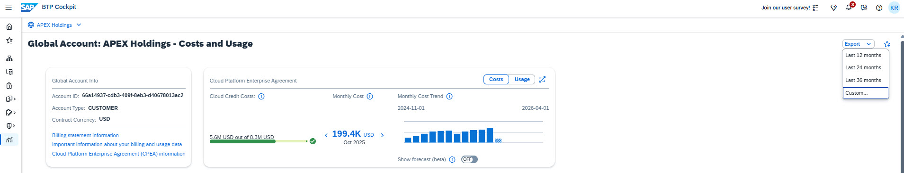

# Exercise 7 - Export to Excel — Optional (approx. 10 minutes)

> [!TIP]
> **This exercise is optional.** Complete it if time allows, or revisit it later using your own SAP BTP account. Ensure labels are assigned to your subaccounts beforehand to maximize the exercise value.

## Exercise 7.1 - Introduction

The **Export to Excel** feature lets you download BTP cost data for the past 12, 24, or 36 months. You can customize the export by applying filters (subaccounts, labels, services) and adding label columns. The exported file integrates with third-party reporting tools.

## Exercise 7.2 - Scenario 1: Share Costs with a Contact Person

**Scenario:** Export cost data filtered by a specific contact person to share relevant costs with a stakeholder.

1. Navigate to the **Billing** tab.
2. Click **"Clear Filters"** to reset any existing filters.
3. Set the **Month** filter to **Previous Month**.
4. In the search box, type `ContactPerson` and use auto-complete to select `ContactPerson alex.yamamoto@apex.com`.
5. Click the small arrow next to the **Export** button and select **"Custom..."**.
6. Verify: time period = previous month; search filter shows `ContactPerson:alex.yamamoto@apex.com`.
7. Keep default settings and click **Export**.
8. Open the exported Excel file from your Downloads folder.
   - The **Global Account Costs** and **Subaccount Costs by Service** sheets are filtered to the selected contact person.
9. In the **Global Account Costs** sheet, select column I (Cost) to see the total cost for this contact in the footer.
10. Use this file to share costs with the contact person and prompt action if needed.

> You can apply the same approach with any label (service, subaccount, department, cost center) to generate stakeholder-specific cost reports.

## Exercise 7.3 - Scenario 2: Aggregate Costs by Cost Center

**Scenario:** Export all costs with a cost center label column, then use Excel's AI analytics to aggregate and compare cost centers.

1. Click **"Clear Filters"** to reset all filters.
2. Set **Month** to **Previous Month**.
3. Click the small arrow next to **Export** and select **"Custom..."**.
4. Confirm no filter is applied ("All filters show (no filter)").
5. In the **"Labels as Columns"** field, enter: `CostCenter`

> [!TIP]
> Adding labels as columns lets you pivot and analyze data by those dimensions in Excel — useful for aggregating costs by business unit, department, or project.

6. Click **Export** and open the downloaded file.
7. Navigate to the **"Subaccount Costs by Service"** sheet.
8. Find the column labeled **"Label Values for Key: CostCenter"** — this contains the cost center assigned to each row. Use Excel's filter on this column to isolate any cost center and sum its total. This column also works as a dimension in a pivot table, giving you a data cube where cost center is one axis of your cost analysis.

### Using Excel's Analyze Data Feature

1. In the Excel **Data** ribbon, click **"Analyze Data"**.
2. In the text box, enter: `Cost by Label Values for Key: CostCenter`
3. Review the generated analysis and click **"Insert PivotChart"** to add it to your worksheet.

   **Which cost center has the highest costs?**

   

   
Answer

   **CC-400**

   *Cost center CC-400 has the highest aggregated costs. This insight helps focus budget adjustments and optimization efforts.*

   

> [!NOTE]
> The Analyze Data feature uses AI to understand your data and generate insights automatically, saving significant time compared to manually building pivot tables.

## Summary

### 🎯 Key Takeaways

- ✅ Export customized cost data (12–36 months) with filters and label columns for tailored reporting
- ✅ Share filtered cost reports by contact person for transparent, data-driven cost discussions
- ✅ Use Excel's AI-powered Analyze Data to aggregate and compare cost centers with natural language
- ✅ Integrate SAP BTP cost data into third-party reporting tools

---

[← Previous: Exercise 6 - Optimization](../ex6-optimization/) | [Continue to: Exercise 8 - TechEd Preview →](../../part2/)
