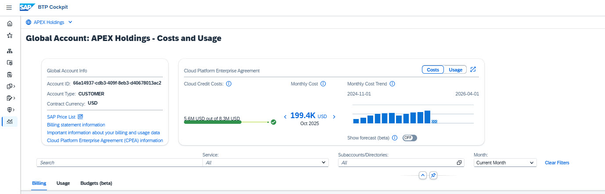

# Exercise 2 - Billing Verification — Optional for newcomers (approx. 10 minutes)

> [!TIP]
> **This exercise is optional.** Complete it if you are new to SAP BTP billing or want to practice verifying costs against a balance statement. Otherwise, proceed directly to [Exercise 3 - Monitoring Costs](../ex3-monitoring-costs/).

## Exercise 2.1 - Orientation

**Screenshot: Costs and Usage header**

1. In the **BTP Cockpit**, navigate to **Costs and Usage** using the left pane.
2. Click the hamburger icon  in the top-left corner to collapse the left pane and expand the viewing area.
3. In the **Global Account Info** card, click the **"Billing Statement Information"** link. This links to SAP for Me where you can download the Balance Statement. For this exercise, screenshots are provided — no SAP for Me login is needed.
4. Click **"Important information about your billing and usage data"**.
5. You will see that Apex Holdings is licensed for both **subscription-based** and **consumption-based** commercial models. Prepaid quota from the subscription is consumed first; any excess is charged under the consumption model.
6. In the header, locate the **Cloud Platform Enterprise Agreement** card showing Cloud Credits, status, and trends.

**Screenshot: Billing View by Service**

7. The **Billing → View by Service** displays and analyzes monthly charges for all billable services consumed over the last 12 months. Two perspectives:
   - **View by Service** — suited for billing verification; ordered as in the balance statement.
   - **View by Account** — suited for cross-charging; shows account hierarchy with costs per entity.

## Exercise 2.2 - Compare the Balance Statement with BTP Cockpit

> [!NOTE]
> The Balance Statement is the starting point for monthly cost verification. Screenshots from the previous month's balance statement are provided below for comparison.

**Screenshot #1: Balance Statement — Total Consumption Section**

1. The default view is **Billing → View by Service**, sorted automatically by Product (SKU) — matching the balance statement order.
2. Select **"Show only services with charged usage"** to filter out services with zero cost. Compare what disappears with what the balance statement shows.
3. Compare the **Usage**, **Prepaid Quota**, and **Charged Usage** columns for the first three services against screenshot #1. If unsure what a column means, click its ⓘ icon.

**Screenshot #2: Balance Statement — Cloud Platform Enterprise Agreement Section**

4. Compare the **List Price** column for the first three services against screenshot #2.
5. Notice that the BTP Cockpit aggregates both balance statement sections into a single view, enabling drill-down per service.

**Screenshot #3: Balance Statement — Cloud Credits and Payment Summary**

6. In screenshot #3 (section 3.A), compare **consumed cloud credits** between the balance statement and the Costs and Usage header.
7. In screenshot #3 (section 3.B), compare **remaining cloud credits** between the balance statement and the header.
8. Remaining cloud credits mean no Net Overage Amount — the Payment Summary shows no additional costs to pay.

> **Note:** Billing verification confirms all charges are accurate. This establishes confidence in the data before further cost analysis.

## Exercise 2.3 - Analyze the Overall Cost Trend

1. Scroll down to the **Global Account — Cost Summary** graph and choose **View By: List Price**.
2. Identify which month has the highest costs over the last 12 months.

   

   
Answer

   **Previous month**

   *The previous month shows the highest costs, indicating a significant increase in consumption. This trend warrants further investigation — which is the focus of Exercise 3.*
   

3. Hover over the current month bar to see estimated costs.

> [!NOTE]
> Current-month costs appear as striped bars — estimates based on raw usage data before billing closes. Once the billing cycle closes and a new Balance Statement is issued, values are finalized.

## Summary

### 🎯 Key Takeaways

- ✅ Navigate the BTP Cockpit Costs and Usage interface
- ✅ Verify balance statement data systematically against BTP Cockpit
- ✅ Validate cloud credit balances
- ✅ Identify cost trends and anomalies for further investigation

---

[← Previous: Exercise 1 - Cost and Usage Overview](../ex1-cost-overview/) | [Continue to: Exercise 3 - Monitoring Costs (Optional) →](../ex3-monitoring-costs/)
